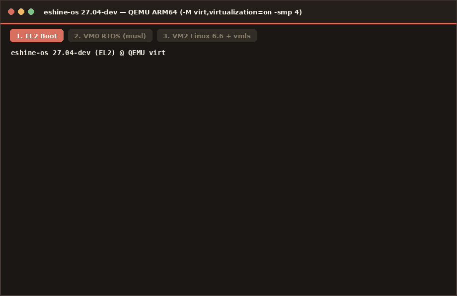
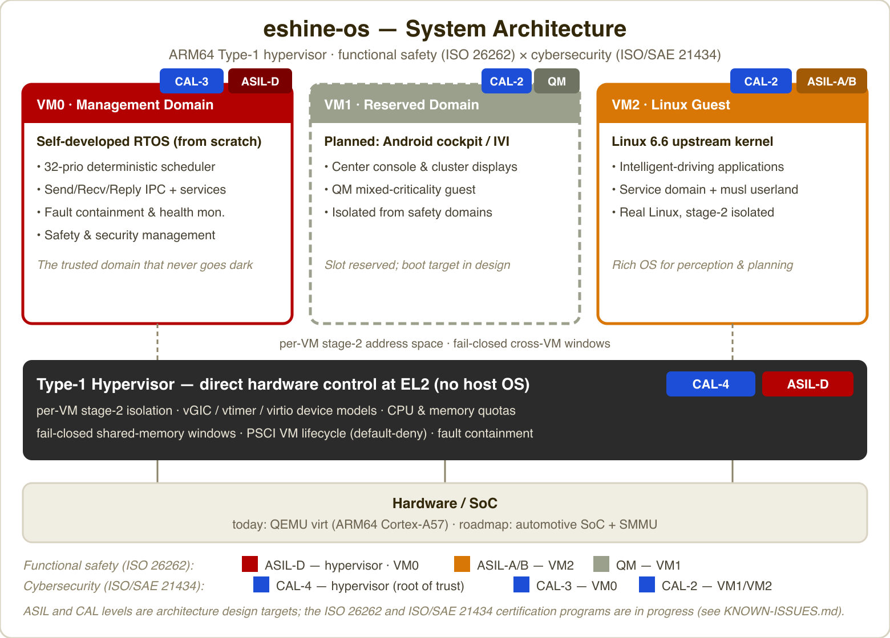

<!-- SPDX-License-Identifier: Apache-2.0 -->
<!-- Copyright (c) 2026 Julian Chu -->

# eshine-os

**[简体中文](README.zh-CN.md)** · **[Website](https://www.eshine-os.org/)** · **[Architecture](ARCHITECTURE.md)** · **[Known Issues](docs/KNOWN-ISSUES.md)**

[](https://github.com/eshine-os/eshine-os/actions/workflows/ci.yml)
[](LICENSE)
[](https://github.com/eshine-os/eshine-os/releases/tag/v26.10)
[](ARCHITECTURE.md)

**An open-source ARM64 Type-1 hypervisor and from-scratch SMP RTOS for automotive autonomous driving and robotics** — running a safety-management RTOS (`VM0`) and upstream Linux 6.6 (`VM2`) side-by-side on one machine with hardware Stage-2 isolation and 173+ replayable QEMU gates.

> 底层之光，守护生命 · The light beneath, guarding life.

## Terminal Demo



*Captured from a single QEMU `virt` (`-smp 4`) session: EL2 hypervisor boot → `VM0` SMP RTOS running musl `/bin/hello` → `VM2` upstream Linux 6.6 running the exact same static musl binary simultaneously (`vmls` shows both `VM_RUNNING`).*

## System Architecture



One machine, three domains — structured along functional safety (**ISO 26262**) and cybersecurity (**ISO/SAE 21434**) isolation boundaries:

| Layer / Domain | Design Target | Current Status | Key Capabilities |
|---|---|---|---|
| **Type-1 Hypervisor (EL2)** | ASIL-D / CAL-4 | **Implemented** | Direct EL2 control with no host OS; per-VM Stage-2 isolation, vGICv3, vtimer, virtio-blk/net, DTB injection, PSCI VM lifecycle, CPU/memory quotas, fail-closed cross-VM windows |
| **VM0 · Management Domain** | ASIL-D / CAL-3 | **Implemented** | From-scratch 2-vCPU SMP RTOS: 32-priority bitmap scheduler, per-process Stage-1 MMU + ASID, Send/Recv/Reply IPC + pulses, futex/signals, ramfs/procfs, HAM health monitor, musl ELF loader |
| **VM1 · Cockpit Slot** | QM / CAL-2 | **Reserved** | Bare-metal fault-isolation test guest today; slot reserved for a future Android cockpit / cluster domain |
| **VM2 · Linux Domain** | ASIL-A/B / CAL-2 | **Implemented** | Upstream Linux 6.6 SMP kernel + busybox initramfs + musl userland for intelligent-driving workloads |

> **Honest boundary:** ASIL (ISO 26262) and CAL (ISO/SAE 21434) levels are architectural design targets; formal third-party certification has not yet started. See [docs/KNOWN-ISSUES.md](docs/KNOWN-ISSUES.md) for current scope and open defects.

## 60-Second Quick Start

### Option A — Pinned Docker / Podman Image (No Local Cross-Toolchain)

```bash
git clone https://github.com/eshine-os/eshine-os.git
cd eshine-os
scripts/container.sh build      # Ubuntu 24.04 + aarch64 cross-gcc + QEMU 8.2.2
scripts/container.sh run        # build and launch interactive QEMU
```

- `scripts/container.sh selftest` runs the container build + fast boot smoke gates (`1..18`).
- Containers default to `--network none`; to fetch/build Linux guest artifacts inside the container, set `ESHINE_CONTAINER_NETWORK=bridge`. Podman is supported via `ESHINE_CONTAINER_ENGINE=podman`. See [docs/DEVELOPMENT-ENV.md](docs/DEVELOPMENT-ENV.md).

### Option B — Native Linux Host

Requirements: `aarch64-linux-gnu-gcc`, `qemu-system-aarch64` (8.2.x), `python3`; optional `dtc`.

```bash
make                # build eshine.elf + rtos.bin + guest2.bin
make verify-fast    # smoke gates (1..18): host EL2 + VM0 boot, no external artifacts
make run            # QEMU virt; auto-fetches Linux/musl/busybox artifacts into .work/
make verify         # full non-heavy green suite (requires .work/ artifacts)
make verify-heavy   # Yocto / image / Docker static gates (local / release)
```

All external artifacts, logs, and sockets stay isolated under `ESHINE_WORK` (default `.work/`). For offline reuse, use `scripts/bootstrap.sh --adopt`.

## What Actually Works Today

- **Clean-room EL2 + RTOS codebase (~24K LOC C/ASM):** Implemented from public ARM architecture and QEMU specifications under Apache-2.0, with SPDX headers on every source file and strict GPL isolation for Linux/BusyBox guest images ([NOTICE](NOTICE), [3rd/LEDGER.md](3rd/LEDGER.md)).
- **True dual-world musl userland:** The exact same static musl ELF binary (`/bin/hello`, BusyBox) executes on both **VM0** (custom RTOS + user-space ELF loader) and **VM2** (upstream Linux 6.6) on the same hypervisor.
- **Fixture-based replayable verification:** Stable gate namespace `1..183` where ordinary gates boot a fresh QEMU session and stateful families run isolated scenario fixtures. GitHub Actions runs **173/173 green gates across 3 shards in ~403 s** (`2026-11-18`); **4** quarantined gates are openly tracked in [tools/verify/quarantine.txt](tools/verify/quarantine.txt).
- **Reproducible packaging:** Kernel-style `Makefile`, host-independence verification (`scripts/check-host-independence.sh`), and a Yocto layer (`meta-eshine`) that builds deployable images from `git archive`.

## AI-Pair Engineering & Evidence Discipline

Initiated by **Julian Chu**, `eshine-os` is built in pair with AI coding models (`Claude Code`, `GLM-5.3`, `DeepSeek V4.1`, `Gemini 4 Neon`) as an engineering experiment in **gate-driven infrastructure development**:

- **AI writes code; replayable QEMU gates judge truth.** Every feature lands as a vertical station slice with a written spec, automated gate assertions, and an honest devlog of bugs and refuted hypotheses ([docs/STATION-PLAYBOOK.md](docs/STATION-PLAYBOOK.md)).
- **Tiered model routing & independent review.** Architecture, security boundaries, and cross-subsystem forensics are separated from implementation throughput and verified with cross-family review artifacts ([docs/MODEL-ROUTING.md](docs/MODEL-ROUTING.md), [docs/reviews/](docs/reviews/)).
- **Real commit attribution.** Every commit declares actual participating models via `Model:` / `Assisted-by:` trailers enforced in CI by [scripts/check-commit-msg.py](scripts/check-commit-msg.py) ([docs/COMMIT-ATTRIBUTION.md](docs/COMMIT-ATTRIBUTION.md)).

## Honest Scope & Boundaries

| Area | Verified Today | Current Limitation / Next Step |
|---|---|---|
| **Platform** | QEMU `virt` ARM64 (`-cpu cortex-a57 -smp 4`) | Real-board bring-up (Board HAL → RPi 5 / RK3588 / SoC) is planned next |
| **QEMU / EL2 MMU** | Verified green on Ubuntu 24.04 / QEMU 8.2.2 | EL2 Stage-1 MMU is not yet enabled; QEMU 10.2.1 hits an EL2 alignment fault ([docs/CI.md](docs/CI.md)) |
| **Safety & Security** | Stage-2 isolation, fail-closed `xvmacl`, per-process Stage-1 MMU | v0 boundary hardening (strict `access_ok`, W^X, 64-bit lock widths, SMP `vmalle1is`, fuzzing) & formal certification pending |
| **Stability** | 173/173 green CI gates across 3 shards | `[37]/[38]` quiet-window double-green closure & `bsh` space-flood root cause tracked in [docs/KNOWN-ISSUES.md](docs/KNOWN-ISSUES.md) |

## Status & Releases

- **`26.10`** — First release (`2026-10-21`): EL2 boot skeleton, default-deny VM state machine, true-green gate ([docs/releases/v26.10/notes.md](docs/releases/v26.10/notes.md)).
- **`27.04-dev`** — Active mainline: 68-station vertical development sequence covering the Type-1 hypervisor, VM0 SMP RTOS, VM2 Linux 6.6 guest, musl userland, and Yocto/container release pipeline.
- **Cadence:** Semi-annual `YY.MM` releases in April and October ([docs/VERSIONING.md](docs/VERSIONING.md)).

## Repositories

- **Primary (GitHub):** <https://github.com/eshine-os/eshine-os.git>
- **Mirror (Gitee):** <https://gitee.com/eshine-os/eshine-os.git>
- **Website:** <https://www.eshine-os.org/>

## Documentation

- [ARCHITECTURE.md](ARCHITECTURE.md) — Hypervisor, RTOS, trap frames, GICv3, and Stage-2 internals
- [docs/state/PROJECT-STATE.md](docs/state/PROJECT-STATE.md) — Current HEAD state, open risks, and next actions
- [docs/KNOWN-ISSUES.md](docs/KNOWN-ISSUES.md) — Honest boundary statement, open defects, and triage rules
- [docs/CI.md](docs/CI.md) — Sharded fixture gate topology, QEMU pin, and red-gate policy
- [docs/DEVELOPMENT-ENV.md](docs/DEVELOPMENT-ENV.md) — `ESHINE_WORK`, bootstrap, and container workflows
- [docs/STATION-PLAYBOOK.md](docs/STATION-PLAYBOOK.md) — Vertical station workflow and Definition of Done
- [docs/MODEL-ROUTING.md](docs/MODEL-ROUTING.md) & [docs/COMMIT-ATTRIBUTION.md](docs/COMMIT-ATTRIBUTION.md) — AI routing and trailer rules
- [docs/specs/](docs/specs/) · [docs/devlog/](docs/devlog/) · [docs/releases/](docs/releases/) · [docs/reviews/](docs/reviews/)

## On the Name

**"eshine"** conveys *"a steady light cast into the foundation"*:

- **e** — embedded, essential base layer;
- **shine** — a reliable light shining upward from the base that does not go out when failures happen.

*(Naming-positioning reading, not an etymological claim.)*

## License

Licensed under **Apache-2.0** (see [LICENSE](LICENSE)). Every source file carries an SPDX header; third-party notices and license isolation boundaries are tracked in [NOTICE](NOTICE) and [3rd/LEDGER.md](3rd/LEDGER.md).
