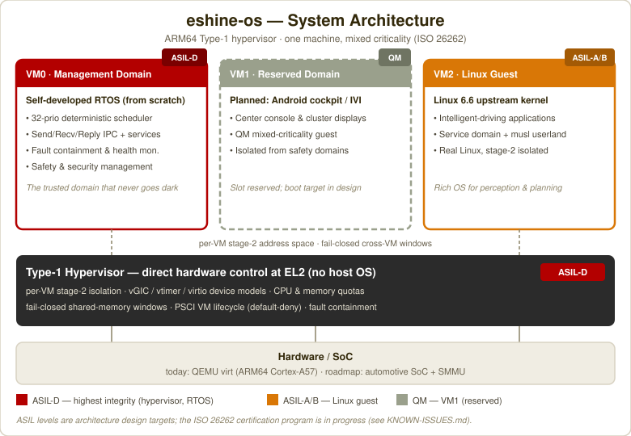

<!-- SPDX-License-Identifier: Apache-2.0 -->
<!-- Copyright (c) 2026 Julian Chu -->
# eshine-os

> 底层之光，守护生命。
> The light beneath, guarding life.

## 我们做什么 / What we build

**与 AI 组队，从零开发车载自动驾驶与机器人的操作系统。**

eshine-os 是面向**车载自动驾驶与机器人**的开源操作系统底座：ARM64 Type-1 虚拟化、从零编写的实时内核、真实 Linux 客机，在同一台机器上以强隔离与确定性时序并行运行。项目由 Julian Chu 发起，与 AI（Claude Code、GLM-5.3 等）结对，从零逐站构建——每一站都有可重放的判据与公开的过程记录。

eshine-os is an open-source OS foundation for **automotive autonomous driving and robotics**: ARM64 Type-1 virtualization, a from-scratch real-time kernel, and a real Linux guest running side by side with strong isolation and deterministic timing. Initiated by Julian Chu and built from zero in pair with AI (Claude Code, GLM-5.3, and others), station by station — each with replayable gates and a public engineering log.

## 系统架构 / System architecture

一台机器上的混合临界度三域架构，按 **ISO 26262** 功能安全设计：

- **Type-1 hypervisor（ASIL-D）**：直驱硬件、无宿主 OS；per-VM stage-2
  地址空间隔离、vGIC/vtimer/virtio 设备模型、CPU/内存配额、
  fail-closed 跨 VM 共享窗。
- **VM0 管理域（ASIL-D）**：自研 RTOS——确定性调度、三段消息 IPC、
  故障遏制与健康监控，是系统的安全管理域。
- **VM1 预留域（QM）**：预留座舱域，未来启动 **Android** 作为
  中控/仪表等座舱应用（槽位已留，启动目标设计中）。
- **VM2 Linux 域（ASIL-A/B）**：真实 Linux 6.6 上游内核，承载
  **智能驾驶应用**与 musl 用户态服务。

> ASIL 分级为架构设计目标，认证路线进行中（见
> [docs/KNOWN-ISSUES.md](docs/KNOWN-ISSUES.md) 的诚实边界声明）。

One machine, three domains, mixed criticality — designed against ISO 26262:

- **Type-1 hypervisor (ASIL-D)** — direct hardware control, no host OS;
  per-VM stage-2 isolation, vGIC/vtimer/virtio, CPU & memory quotas,
  fail-closed cross-VM shared windows.
- **VM0 management domain (ASIL-D)** — the from-scratch RTOS:
  deterministic scheduling, Send/Recv/Reply IPC, fault containment and
  health monitoring; the safety management domain of the system.
- **VM1 reserved domain (QM)** — reserved for the cockpit; planned to
  run **Android** as the center-console / cluster domain.
- **VM2 Linux domain (ASIL-A/B)** — real upstream Linux 6.6 carrying
  **intelligent-driving applications** and the musl userland.

## 仓库 / Repositories

- **主仓 / Primary**: <https://github.com/eshine-os/eshine-os.git>
- **镜像 / Mirror**: <https://gitee.com/eshine-os/eshine-os.git>

## 命名寓意 / On the name

"eshine" 寄意「铸入底层的恒明之光」：

- **e** —— 嵌入式、不可或缺的底层基座（embedded / essential）；
- **shine** —— 自底向上、经久不熄的可靠之光。

"eshine" carries the sense of "a steady light cast into the foundation":

- **e** — the embedded, indispensable base layer (embedded / essential);
- **shine** — a reliable light, shining upward from the base, that does not go out.

在最易生险的边缘地带，这层基座以强隔离与确定性时序，把高可靠与高安全从地基向上递送至生命攸关的负载；在故障降临时，做那盏不闪、不灭、不弃人的稳光。

In the most risk-prone edge zones, this base layer delivers high reliability and high safety upward to life-critical workloads through strong isolation and deterministic timing — becoming, when failure arrives, the steady light that does not flicker, does not go out, does not abandon people.

> 上述为命名定位读法，非语源断言；跨语读音联想属 evocation，不主张词源。
> This is a naming-positioning reading, not an etymological claim; cross-linguistic sound associations are evocations, not asserted origins.

## 当前形态 / Current shape

- **EL2 Type-1 hypervisor**：VM 抽象、vCPU 上下文、GICv3/vGIC、vtimer、virtio-blk/net、DTB 注入、PSCI、per-VM 隔离与配额。
- **VM0：从零自研 RTOS**：抢占式调度、进程与地址空间（stage-1 页表/ASID/缺页）、三段消息 IPC（Send-Recv-Reply + 脉冲）、signal/futex、rootfs 与 fd 服务、procfs、跨 VM 服务面。
- **VM1/VM2**：VM1 为**预留座舱域**（现为裸机对照 guest；未来启动 Android
  作为中控/仪表）；VM2 为**真实 Linux 6.6 guest**（busybox initramfs，
  目标=智能驾驶应用域）。
- **真 musl 用户态**：同一份静态 musl ELF 在 VM0（自研内核 + 用户态 loader）与 VM2（真实 Linux）上得到相同输出——同 libc，两个世界，一台 hypervisor。
- **门禁**：183 道可重放判据，站点收口以两连真绿为准。
- **构建**：kernel 风格 Makefile；Yocto 层 `meta-eshine` 可从 `git archive` 提交树构建部署件。
- **验证平台**：QEMU virt（ARM64）。真板路线在规划中。

## 状态 / Status

- **`26.10`** — 首个版本 / First release（2026-10-21）：EL2 骨架、VM 状态机、真绿门禁，见 [docs/releases/v26.10](docs/releases/v26.10/notes.md)。
- 开发线 / Development line：`27.04-dev` —— 68 站开发序列，覆盖 hypervisor、RTOS、用户态与构建发布面。
- 发布节奏 / Cadence：每年 4 月 / 10 月（YY.MM），版本策略见 [docs/VERSIONING.md](docs/VERSIONING.md)。
- 目标架构 / Target architecture：Type-1 hypervisor + 管理 RTOS VM + Linux guest VM。
- 已知问题与边界 / Known issues and scope：[docs/KNOWN-ISSUES.md](docs/KNOWN-ISSUES.md)。

## 快速开始 / Quick start

    make                # build eshine.elf + rtos.bin + guest2.bin
    make bootstrap      # populate .work (fetch pins; see --adopt for existing)
    make run            # QEMU virt; auto-fetches missing .work artifacts
    make verify-fast    # fast loop (gates 1-36; stops before the open [37]/[38] family)
    make verify         # full 183 gates (needs .work artifacts + Yocto)

    scripts/container.sh build      # pinned toolchain image
    scripts/container.sh run        # interactive QEMU in the container
    scripts/container.sh selftest   # container build + fast gates

### 在 Docker 里跑 / Run in Docker

无本地交叉工具链时，一条路是固定镜像（Ubuntu 24.04 + cross gcc + QEMU 8.2 + dtc + gdb）：

    scripts/container.sh build                    # 一次：建 pinned 镜像
    scripts/container.sh run                      # 交互 QEMU（= 容器内 make run）
    scripts/container.sh verify --stop-after=36   # 容器内重建 + 快环门禁
    scripts/container.sh shell                    # 容器内交互 bash

- 仓库挂 `/src`、工作根 `.work` 挂 `/work`：`.work` 在宿主填充一次，容器直接复用。
- 容器默认 `--network none`，**不能在容器内 fetch**；要容器内从零 bootstrap 用
  `ESHINE_CONTAINER_NETWORK=bridge`。
- 支持 podman：`ESHINE_CONTAINER_ENGINE=podman`。

No local toolchain needed: the pinned image builds and runs the same
tree against the same `.work`. The container defaults to
`--network none` (populate `.work` on the host, or set
`ESHINE_CONTAINER_NETWORK=bridge` to bootstrap inside). Details:
[docs/DEVELOPMENT-ENV.md](docs/DEVELOPMENT-ENV.md).

依赖 / deps: cross toolchain and QEMU (or Docker), `python3`; optional `dtc`.
工作根 / work root: `.work/` (override with `ESHINE_WORK`). See
[docs/DEVELOPMENT-ENV.md](docs/DEVELOPMENT-ENV.md).

## 文档 / Docs

- [ARCHITECTURE.md](ARCHITECTURE.md) — 架构与关键机制
- [docs/specs/](docs/specs/) — 逐站设计文档
- [docs/devlog/](docs/devlog/) — 开发日志（双语）
- [docs/content/](docs/content/) — 每站技术内容包
- [docs/KNOWN-ISSUES.md](docs/KNOWN-ISSUES.md) — 已知问题与边界
- [docs/DEVELOPMENT-ENV.md](docs/DEVELOPMENT-ENV.md) — 工作根、bootstrap、容器
- [docs/STATION-PLAYBOOK.md](docs/STATION-PLAYBOOK.md) — 站点流程与 DoD
- [docs/MODEL-ROUTING.md](docs/MODEL-ROUTING.md) — 模型路由与证据纪律
- [docs/state/PROJECT-STATE.md](docs/state/PROJECT-STATE.md) — 当前状态与下一步

## License

Apache-2.0（见 / See [LICENSE](LICENSE)）。每个源文件带 SPDX 标记；第三方组件见 [NOTICE](NOTICE) 与 [3rd/LEDGER.md](3rd/LEDGER.md)。
