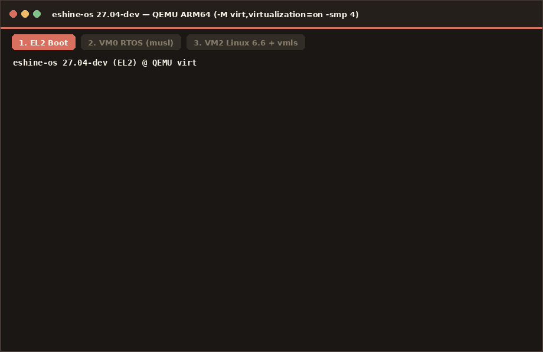
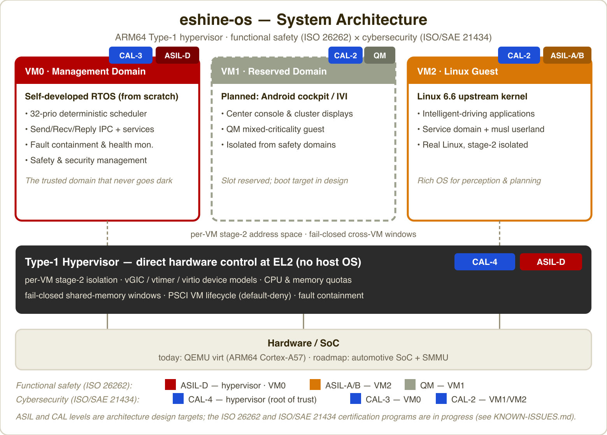

<!-- SPDX-License-Identifier: Apache-2.0 -->
<!-- Copyright (c) 2026 Julian Chu -->

# eshine-os

**[English](README.md)** · **[官网 / Website](https://www.eshine-os.org/zh/)** · **[架构文档](ARCHITECTURE.md)** · **[已知问题与边界](docs/KNOWN-ISSUES.md)**

[](https://github.com/eshine-os/eshine-os/actions/workflows/ci.yml)
[](LICENSE)
[](https://github.com/eshine-os/eshine-os/releases/tag/v26.10)
[](ARCHITECTURE.md)

**面向车载自动驾驶与机器人的开源 ARM64 Type-1 Hypervisor 与自研 SMP RTOS** —— 在同一台机器上以硬件 Stage-2 隔离并行运行安全管理域 RTOS（`VM0`）与真实上游 Linux 6.6（`VM2`），配备 173+ 条可重放 QEMU 自动化验证门禁。

> 底层之光，守护生命 · The light beneath, guarding life.

## 终端演示



*录自单次连续 QEMU `virt`（`-smp 4`）会话：EL2 Hypervisor 引导 → `VM0` 自研 SMP RTOS 运行静态 musl `/bin/hello` → `VM2` 上游 Linux 6.6 同机运行完全相同的 musl ELF 可执行文件（`vmls` 显示两个域同时处于 `VM_RUNNING`）。*

## 系统架构



一芯三域混合临界度架构，按 **ISO 26262** 功能安全与 **ISO/SAE 21434** 信息安全双维度设计隔离边界：

| 层级 / 域 | 设计目标等级 | 当前状态 | 核心能力 |
|---|---|---|---|
| **Type-1 Hypervisor (EL2)** | ASIL-D / CAL-4 | **已实现** | 无宿主 OS 直驱硬件；per-VM Stage-2 地址隔离、vGICv3、vtimer、virtio-blk/net、DTB 注入、PSCI 生命周期状态机、CPU/内存配额、fail-closed 跨 VM 共享窗 |
| **VM0 · 管理域 RTOS** | ASIL-D / CAL-3 | **已实现** | 从零编写双核 SMP 实时内核：32 级位图抢占调度、进程 Stage-1 MMU + ASID、三段同步消息 IPC 与脉冲、futex/signal、ramfs/procfs、HAM 健康监控、musl ELF 加载器 |
| **VM1 · 预留座舱域** | QM / CAL-2 | **槽位预留** | 当前运行裸机故障隔离对照客机，槽位预留给后续 Android 中控/仪表座舱域 |
| **VM2 · Linux 域** | ASIL-A/B / CAL-2 | **已实现** | 上游真实 Linux 6.6 SMP 内核 + busybox initramfs + musl 用户态，承载智驾应用与富生态服务 |

> **诚实边界声明：** ASIL（ISO 26262）与 CAL（ISO/SAE 21434）分级均为架构设计目标，尚未启动第三方认证。当前全部边界与已知问题详见 [docs/KNOWN-ISSUES.md](docs/KNOWN-ISSUES.md)。

## 60 秒快速开始

### 方式 A — 固定 Docker / Podman 镜像（免配本地交叉工具链）

```bash
git clone https://gitee.com/eshine-os/eshine-os.git
cd eshine-os
scripts/container.sh build      # Ubuntu 24.04 + aarch64 cross-gcc + QEMU 8.2.2
scripts/container.sh run        # 一键构建并启动交互式 QEMU
```

- 执行 `scripts/container.sh selftest` 可在容器内完成重建与快环冒烟门禁（`1..18`）。
- 容器默认 `--network none`；若需在容器内拉取并构建 Linux 客机工件，请设置 `ESHINE_CONTAINER_NETWORK=bridge`。支持 Podman（`ESHINE_CONTAINER_ENGINE=podman`）。详见 [docs/DEVELOPMENT-ENV.md](docs/DEVELOPMENT-ENV.md)。

### 方式 B — 本地 Linux 宿主

依赖：`aarch64-linux-gnu-gcc`、`qemu-system-aarch64`（8.2.x）、`python3`；可选 `dtc`。

```bash
make                # 构建 eshine.elf + rtos.bin + guest2.bin
make verify-fast    # 快环冒烟门禁（1..18）：host + VM0 启动，无需外部工件
make run            # 启动 QEMU virt（自动补齐 .work/ 下的 Linux/musl/busybox 工件）
make verify         # 完整非 heavy 绿套件（需 .work/ 工件）
make verify-heavy   # Yocto / 镜像 / Docker 静态门禁（本地与发布）
```

所有外部工件、日志与 socket 均收敛在 `ESHINE_WORK`（默认 `.work/`）下，绝不污染宿主目录；离线迁移可使用 `scripts/bootstrap.sh --adopt`。

## 当前已跑通的能力

- **净室编写的 EL2 + RTOS 底座（约 2.4 万行 C/汇编）：** 基于公开 ARM 与 QEMU 规范从零编写，Apache-2.0 协议，全源码带 SPDX 头，并与 GPL 客机工件严格物理隔离（[NOTICE](NOTICE)、[3rd/LEDGER.md](3rd/LEDGER.md)）。
- **双世界一致的 musl 用户态：** 同一份静态链接 musl ELF（`/bin/hello`、BusyBox）在 **VM0**（自研内核 + 用户态加载器）与 **VM2**（真实 Linux 6.6）上产出完全一致的结果。
- **独立 Fixture 可重放门禁体系：** 稳定编号空间 `1..183`，普通门各自冷启 QEMU、状态家族运行独立场景。GitHub Actions 三分片已跑通 **173/173 全绿（总耗时 ~403 秒）**；剩余 **4** 道隔离门公开记录在 [tools/verify/quarantine.txt](tools/verify/quarantine.txt)。
- **可复现工程化链路：** 内核风格 `Makefile`、宿主无关性检查（`scripts/check-host-independence.sh`）以及从 `git archive` 构建部署件的 `meta-eshine` Yocto 层。

## AI 结对工程化与证据纪律

本项目由 **Julian Chu** 发起，与多代 AI 模型（`Claude Code`、`GLM-5.3`、`DeepSeek V4.1`、`Gemini 4 Neon`）协同构建，核心理念是 **门禁驱动的 AI 系统编程**：

- **AI 产出代码，可重放 QEMU 门禁裁决真伪。** 每个特性站按“规格 → 实现 → 自动化门禁 → 实证日志”推进，诚实记录踩坑与被证伪假设（[docs/STATION-PLAYBOOK.md](docs/STATION-PLAYBOOK.md)）。
- **分层模型路由与跨模型独立评审。** 架构约束、安全边界与跨子系统排障由高阶模型把关，并留存独立审查归档（[docs/MODEL-ROUTING.md](docs/MODEL-ROUTING.md)、[docs/reviews/](docs/reviews/)）。
- **真实署名校验。** 每次提交须通过 `Model:` / `Assisted-by:` trailer 记录真实参与模型，并由 CI 执行 [scripts/check-commit-msg.py](scripts/check-commit-msg.py) 强制校验（[docs/COMMIT-ATTRIBUTION.md](docs/COMMIT-ATTRIBUTION.md)）。

## 诚实边界与待收敛项

| 维度 | 当前已验证状态 | 现有局限 / 下一步路线 |
|---|---|---|
| **运行平台** | QEMU `virt` ARM64（`-cpu cortex-a57 -smp 4`） | 真板 Bring-up（Board HAL → 树莓派 5 / RK3588 / 车规 SoC）规划中 |
| **QEMU / EL2 MMU** | Ubuntu 24.04 / QEMU 8.2.2 全绿 | EL2 Stage-1 MMU 尚未开启，QEMU 10.2.1 会触发对齐异常（[docs/CI.md](docs/CI.md)） |
| **安全与合规** | Stage-2 隔离、`xvmacl` 默认拒绝、进程 Stage-1 MMU | `access_ok`/W^X/64 位锁位宽/跨核 TLBI 修真、边界 fuzzing 及第三方认证待完成 |
| **稳定性** | CI 三分片 173/173 绿灯 | `[37]/[38]` 安静窗两连绿收口与 `bsh` 空格洪水根因闭合见 [docs/KNOWN-ISSUES.md](docs/KNOWN-ISSUES.md) |

## 版本与状态

- **`26.10`**（2026-10-21 首个稳定版）：EL2 骨架、默认拒绝 VM 状态机、真绿验证门禁（[docs/releases/v26.10/notes.md](docs/releases/v26.10/notes.md)）。
- **`27.04-dev`**（当前主线）：68 站垂直开发序列，覆盖 Type-1 Hypervisor、VM0 SMP RTOS、VM2 Linux 6.6、musl 用户态与 Yocto/容器发布流水线。
- **发布节奏：** 每年 4 月 / 10 月固定 `YY.MM` 节奏（[docs/VERSIONING.md](docs/VERSIONING.md)）。

## 仓库地址

- **GitHub 主仓：** <https://github.com/eshine-os/eshine-os.git>
- **Gitee 国内镜像：** <https://gitee.com/eshine-os/eshine-os.git>
- **项目官网：** <https://www.eshine-os.org/zh/>

## 文档导航

- [ARCHITECTURE.md](ARCHITECTURE.md) — Hypervisor、RTOS、陷阱帧、GICv3 与 Stage-2 内部机制
- [docs/state/PROJECT-STATE.md](docs/state/PROJECT-STATE.md) — 当前 HEAD 状态、挂账风险与下一步计划
- [docs/KNOWN-ISSUES.md](docs/KNOWN-ISSUES.md) — 已知缺陷、边界声明与分诊纪律
- [docs/CI.md](docs/CI.md) — 分片门禁拓扑、QEMU 版本锁与隔离门策略
- [docs/DEVELOPMENT-ENV.md](docs/DEVELOPMENT-ENV.md) — `ESHINE_WORK`、bootstrap 与容器开发指南
- [docs/STATION-PLAYBOOK.md](docs/STATION-PLAYBOOK.md) — 站点开发流程与完成定义（DoD）
- [docs/MODEL-ROUTING.md](docs/MODEL-ROUTING.md) & [docs/COMMIT-ATTRIBUTION.md](docs/COMMIT-ATTRIBUTION.md) — 模型路由与提交署名规则
- [docs/specs/](docs/specs/) · [docs/devlog/](docs/devlog/) · [docs/releases/](docs/releases/) · [docs/reviews/](docs/reviews/)

## 命名寓意

**"eshine"** 寄意「铸入底层的恒明之光」：

- **e** —— 嵌入式、不可或缺的底层基座（embedded / essential）；
- **shine** —— 自底向上、经久不熄的可靠之光。

*（以上为命名定位读法，非词源考据。）*

## 开源协议

基于 **Apache-2.0** 协议开源（见 [LICENSE](LICENSE)）。所有源文件均带 SPDX 标记；第三方组件及协议隔离边界详见 [NOTICE](NOTICE) 与 [3rd/LEDGER.md](3rd/LEDGER.md)。
